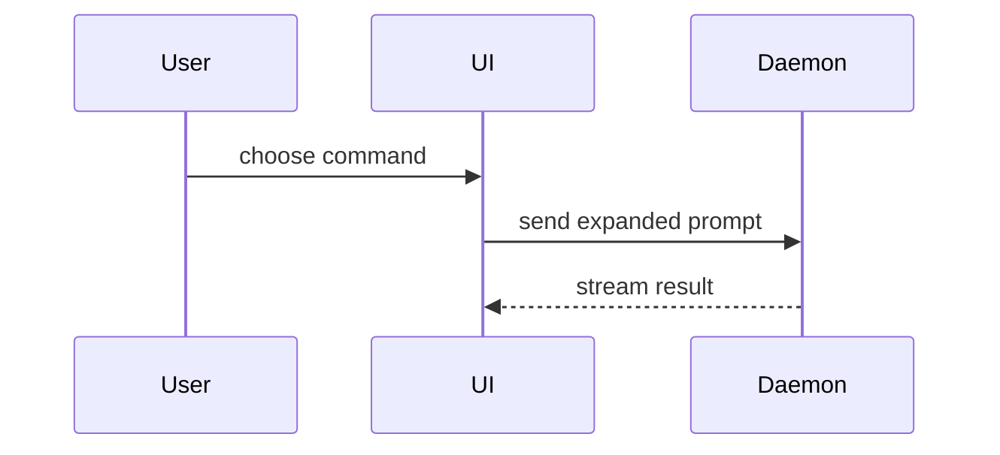

PR 본문은 이 템플릿으로 쓴다.

```markdown
## Summary

<다이어그램, diff 스케치, 또는 트리>

## Evidence

- **Before:** <스크린샷/출력/실패하는 테스트 실행>
  **After:** <스크린샷/출력/통과하는 테스트 실행>

## Merge Danger

**Door:** <one-way 또는 two-way>

<선택: 설명>

**Blast Radius:** <한 단어 설명>

<선택: 머지의 잠재적 파급>
```

## 섹션

서두는 모두 건너뛰고 산문은 짧게 쓴다. `GLOSSARY.md`에 있는 사용자의 도메인 언어를 쓴다.

### Summary

핵심을 분명히 보여 주는 가장 작은 뷰를 고른다.

- 로직이나 알고리즘은 pseudocode로 보인다.

```text
on(save)
  if content is unchanged
    return cached result
  write new content
  return fresh result
```

- 런타임 제어 흐름은 call tree로 보인다.

```text
submitForm
  createSession
    persistPrompt
    launchAgent
  navigateToSession
```

- UI 구조는 component tree로 보이되, 중요한 상태와 모듈 경계를 포함한다.

```text
<SessionPage> (apps/example/src/routes/session.tsx)
  useSessionEvents()
  <SessionToolbar>
    <RunSkillButton> (packages/ui)
```

- 파일의 책임이나 넓은 리팩터링은 얕은 file tree로 보인다.

```text
src/
├── commands/       # parses user actions
├── sessions/       # owns session state
└── transport/      # sends API requests
```

- 컴포넌트 상호작용, 제어 흐름, 데이터 흐름은 Mermaid로 보인다.



- 무엇이 바뀌는지가 핵심이고 주변 모양이 이미 있을 때는 `diff`를 쓴다. diff의 모양은 주제에 맞춘다.

컴포넌트 변경:

```diff
 <SessionPage>
   useSessionEvents()
   <SessionToolbar>
+    <RunSkillButton />
   <SessionTimeline>
+    <SkillResultCard />
```

파일 배치 변경:

```diff
 src/
 ├── commands/
+│   └── show-me.ts       # expands the slash command
 ├── sessions/
-└── transport.ts
+└── transport/
+    ├── client.ts
+    └── stream.ts
```

call tree나 call stack 변경:

```diff
 submitForm
   createSession
     persistPrompt
+    expandSkillMention
     launchAgent
-  navigateToSession
+  navigateToSession
+    subscribeToEvents
```

상태나 제어 흐름 변경:

```diff
 on(save)
-  write content
+  if content is unchanged
+    return cached result
+  write new content
+  invalidate cache
```

- 대부분이 새것일 때, 생략한 맥락이 소유권이나 순서를 가릴 때, 사용자가 복사해 쓸 목표 모양이 필요할 때는 블록 전체를 보인다.

```ts
function expandSkill(command: string): string {
  const skillName = command.slice(1);
  return `use the ${skillName} skill`;
}
```

#### 지침

각 시각 자료는 그것이 뒷받침하는 짧은 글 바로 옆에 둔다. 사용자의 현재 질문, 또는 지금 논의점을 풀 선택지에 답하는 데 필요한 호출, 파일, props, 상태, 경계만 남긴다.

이 중 하나만 써도 되고 여럿을 써도 된다. 전부 쓰는 일은 드물다. 판단해서 쓰고 사용자를 압도하지 않는다.

### Evidence

변경이 동작한다는 구체적인 증거. before와 after를 보인다.

스크린샷은 S급이다. 환경이 갖춰져 있고 변경이 시각적일 때 쓴다.

실행 기반 증거는 A급이다. 테스트 결과, 콘솔 출력. 이제 실패하다가 통과하는 바로 그 테스트를 pseudocode로 보인다.

### Merge Danger

one-way door인지 two-way door인지 서술한다. two-way door는 되돌아 나올 수 있지만 one-way door는 그럴 수 없다. 롤백 비용이 싼 PR은 위험이 낮다. 파괴적인 동작이나 되돌리기 어려운 결정을 담은 변경은 one-way door다.

blast radius는 이 PR이 들이는 변경의 잠재적인 영향 또는 범위다. 가능한 모든 경우를 고려한다. 예를 들면 레이아웃 이동, 소비자 쪽 breakage, 모바일 반응형 등이다.

> 원본: mattpocock/skills@59db609 · skills/engineering/pr/SKILL.md · MIT (THIRD_PARTY_NOTICES.md)
